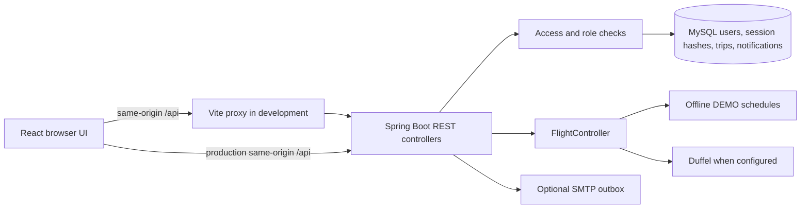
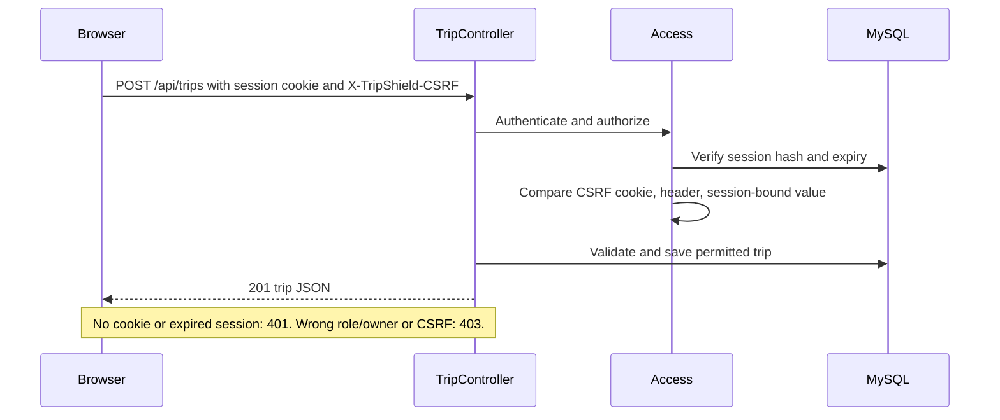
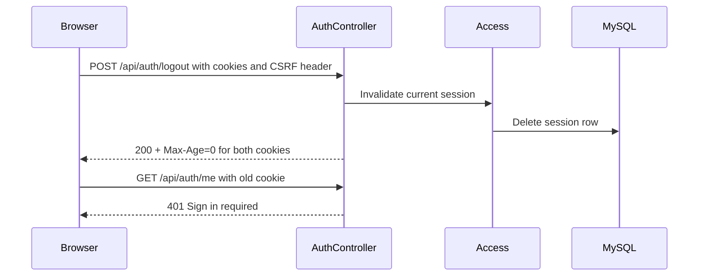
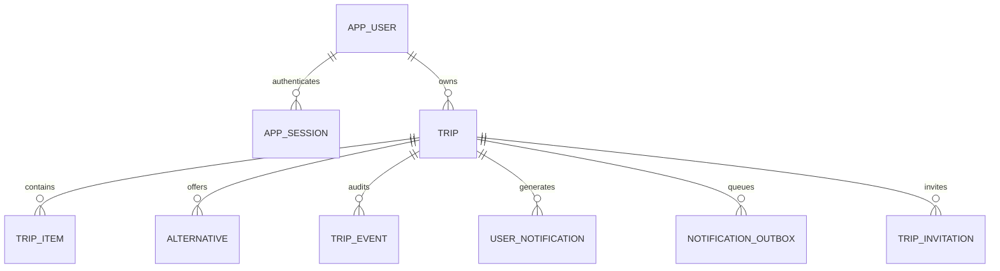

# TripShield web technology and system design

Verified against the shared application on 2026-10-29. Demo and Normal Mode use the same frontend, controllers, entities, and authorization code. They differ in database, seed records, flight source, and external service configuration.

## Architecture



React 19, TypeScript, Vite, and Leaflet render the UI. Java 21+, Spring Boot 4, JPA, Flyway, and MySQL provide REST endpoints and persistence. The same `pom.xml`, `package.json`, and builds serve both modes. `application-demo.properties` forces demo flights and the dedicated demo database. `application-local.properties` selects local database credentials; Duffel is optional. The frontend uses the same API client and Vite proxy in either mode.

## Implemented concepts

| Concept | Status and source |
| --- | --- |
| Authentication | Email/password in `security/AuthController.java`; incorrect credentials return 401. Traveler registration is public; the coordinator is bootstrapped from private configuration on first successful login. |
| Password storage | BCrypt hashes in `app_user.password_hash`; plaintext passwords are not stored in the database. |
| Sessions | Server-side `app_session` rows hold SHA-256 hashes of 256-bit random session tokens, user ID, and fixed 12-hour expiry (`Access.java`, `AppSession.java`). This is not a JWT or a servlet `HttpSession`. |
| Browser cookies | Browser login/register sends `X-TripShield-Browser: 1`; the response sets `TRIPSHIELD_SESSION` (`HttpOnly`, `SameSite=Lax`, `Path=/api`, 12-hour max age) and a JavaScript-readable `TRIPSHIELD_CSRF` (`SameSite=Lax`, `Path=/`). `Secure` is set when the request is HTTPS. Local HTTP does not set `Secure`. The browser receives no raw token in the JSON body. |
| Legacy API bearer support | API clients without the browser header still receive a bearer token and send `Authorization: Bearer ...`. This uses the same server-side session table. The React app never stores this token. |
| Persistence and rotation | `useSession.ts` calls `/api/auth/me` on load/refresh. A new login invalidates the supplied prior session and issues a new random token. There is no sliding renewal; the expiry remains 12 hours from issuance. |
| Logout/expiration | Logout deletes the server row and clears both cookies. Expired rows are rejected and deleted on access. Browser callers are sent back to login after a later 401. |
| Authorization | `Access.java` checks role and stable `ownerUserId`; coordinator-only mutations and traveler ownership checks run on the server. Hidden UI buttons are not the security boundary. Unauthenticated requests return 401 and forbidden role/ownership requests return 403. |
| CSRF | Cookie-authenticated state-changing requests require a custom `X-TripShield-CSRF` header equal to the CSRF cookie and a value derived from that session's stored hash. Missing/mismatched values return 403. Bearer requests are exempt because browsers do not attach bearer headers automatically. Login/register use a custom browser header to obtain cookies. |
| CORS | No cross-origin API access is configured. The development Vite proxy and deployment should serve the UI and `/api` from one browser origin. Cookies use host-only scope. |
| XSS | React escapes ordinary text; session cookies are HttpOnly, so browser scripts cannot read the session token. No CSP is configured, and a script running in the origin could still make authenticated requests. Avoid unsafe HTML and add a deployment CSP as a future hardening step. |
| Validation and errors | Jakarta validation and controller checks reject invalid inputs. `ApiErrors.java` returns Problem Details with safe messages and field errors. Server stack traces are disabled in API responses. |

`server.forward-headers-strategy=framework` should be configured only behind a trusted HTTPS reverse proxy so Spring sees the original secure request and sets `Secure` cookies. Serve `/api` and the UI on the same origin. Do not enable arbitrary credentialed CORS.

## Session and request sequence

```mermaid
sequenceDiagram
  participant B as Browser
  participant A as AuthController
  participant S as Access
  participant D as MySQL
  B->>A: POST /api/auth/login, credentials, X-TripShield-Browser: 1
  A->>D: Find user and verify BCrypt hash
  A->>S: Invalidate supplied old session; issue random token
  S->>D: Store SHA-256 token hash, user ID, expiry
  A-->>B: 200 role/name + HttpOnly session and CSRF cookies
  B->>A: GET /api/auth/me with session cookie
  A->>S: Resolve cookie token
  S->>D: Find hash and check expiry/user
  A-->>B: 200 authenticated profile
```





## Database and REST lifecycle



The `trip` owner is represented by `owner_user_id`, checked in application code. The diagram shows logical relationships; not every link is a physical foreign-key constraint. Flyway V1/V2 define the shared schema. The real development database has an extra unused `recovery_proposal` table and V3 history entry from an incomplete prior attempt; this was not changed during the security work.

`GET` reads trips, options, notifications, or health; `POST` creates trips, simulates disruptions, applies recovery, checks in, and logs in/out; `PUT` updates trips. Successful creation returns 201. Validation returns 400, missing authentication 401, forbidden access or CSRF 403, missing resources 404, duplicate/conflicting state 409, and unavailable upstream service can return 502/503. A request reaches a controller, resolves its server-side session, checks role/owner and CSRF where needed, validates input, performs service/repository work, and returns JSON or Problem Details.

## Security limits

There is no rate limiting, forced revoke-all-sessions, account disable feature, email verification, or CSP. There is no separate browser route authorization layer: React renders login or the authenticated workspace at `/`, while APIs enforce access. The fixed 12-hour session is not renewed automatically. Optional SMTP has at-least-once retry semantics. Live Duffel and real SMTP delivery require separate integration testing. Demo flights are simulated planning data, never live inventory.
